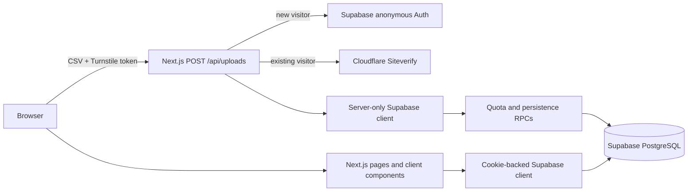

# Architecture

## System overview

The application is a single Next.js App Router project. It has no separately
deployed API service. Route handlers and server actions access Supabase using
either the visitor's cookie-backed client or a server-only administration client.

## Frontend

- `app/` contains routes, layout, loading UI, route handlers, and server actions.
- `components/` contains page-level UI, shared primitives, charts, reports, and
  the Turnstile widget.
- Client components manage local interaction state such as selected datasets,
  chart controls, dialogs, and upload feedback. Server state is read from
  Supabase through server components/actions rather than a separate client-state
  library.
- Styling is Tailwind CSS with CSS variables in `app/globals.css`; shared
  primitives use the `cn` helper in `lib/utils.ts`.

## Upload and persistence flow

1. The browser selects a CSV and completes Turnstile.
2. `POST /api/uploads` fails closed unless `UPLOADS_ENABLED` is exactly `true`.
   It also checks same-origin multipart requests and the bounded file envelope.
3. A first upload creates a Supabase anonymous session through Auth CAPTCHA. An
   existing session verifies its single-use token with Cloudflare Siteverify.
4. The server reserves a quota attempt through a server-only database RPC,
   parses/validates UTF-8 CSV, and calculates the analysis synchronously.
5. A restricted RPC atomically stores metadata, ordered `dataset_rows`, and
   `dataset_analyses`.
6. Visitor reads/deletes use the cookie-backed client and owner-scoped RLS.
   Data previews are paged; charts use a deterministic bounded sample; reports
   use stored analysis and authoritative row counts.

## Identity, authorization, and retention

Supabase anonymous Auth creates an `authenticated` Postgres role session. RLS
allows that anonymous owner to read active datasets/analyses and delete its own
records. Browser writes are not granted. The service role alone runs the
reservation and persistence RPCs after application validation.

Dataset visibility expires after 24 hours. A Supabase Cron job performs physical
cleanup later. Treat the versioned migrations as the source of truth for schema,
RLS, grants, RPCs, and retention behavior.

## External integrations

| Integration | Role |
|---|---|
| Supabase | Anonymous Auth, PostgreSQL, RLS, restricted RPCs, and scheduled cleanup. |
| Cloudflare Turnstile | Upload challenge and verification. |
| Vercel | Inferred deployment platform from repository runtime configuration and operational documentation; no deployment IaC is committed. |

## Important decisions

- CSV handling is deliberately synchronous and bounded; this is a small-file
  exploratory-analysis demo, not a large-data processing platform.
- Rows are stored individually, while `datasets.row_count` is authoritative.
  The legacy JSONB payload stays empty for forward compatibility.
- Statistics and correlation behavior are deterministic. See
  [`DECISION.md`](../DECISION.md) for the complete semantic contract.
- Reports use browser Print/Save as PDF instead of raster/PDF generation.
